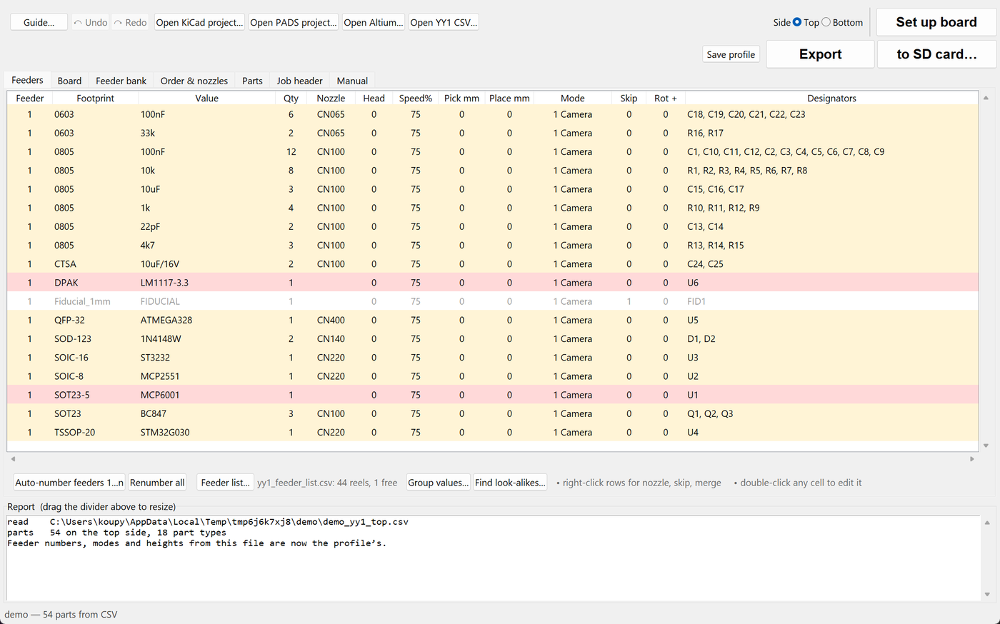
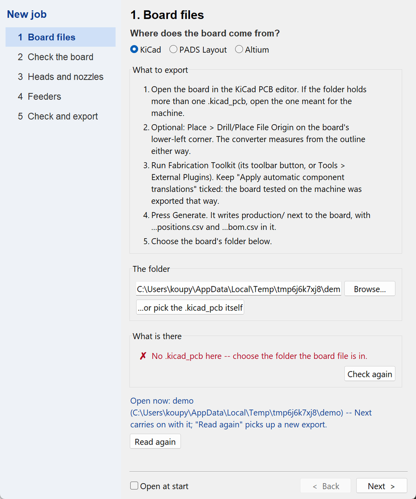
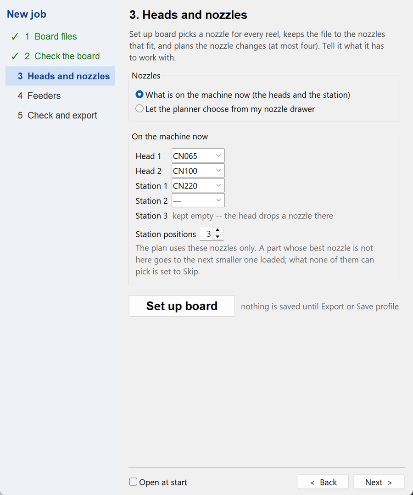
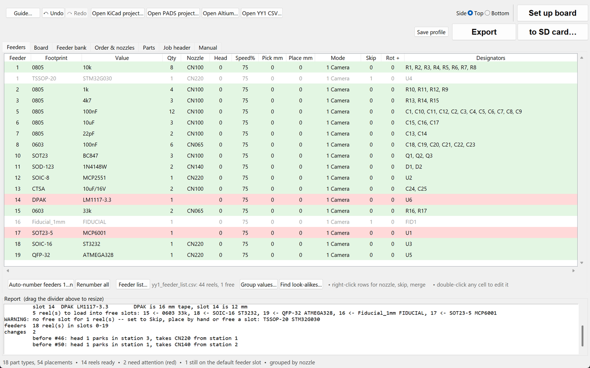
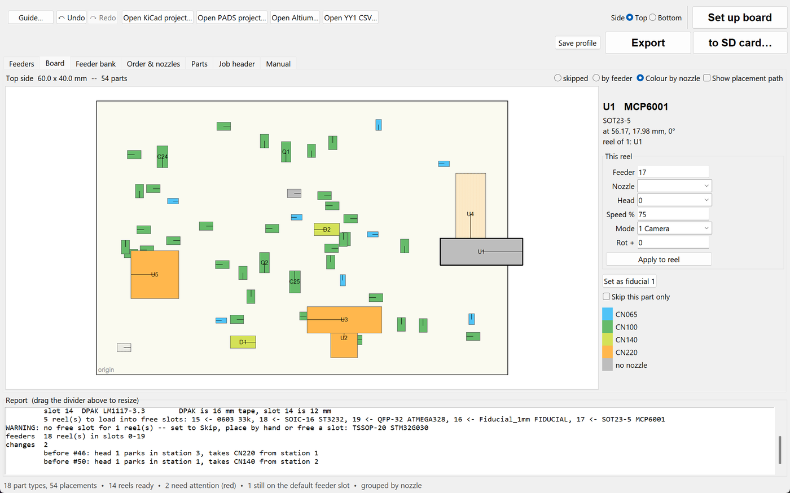
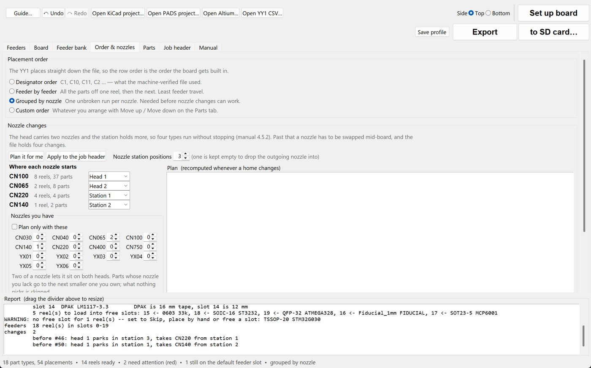
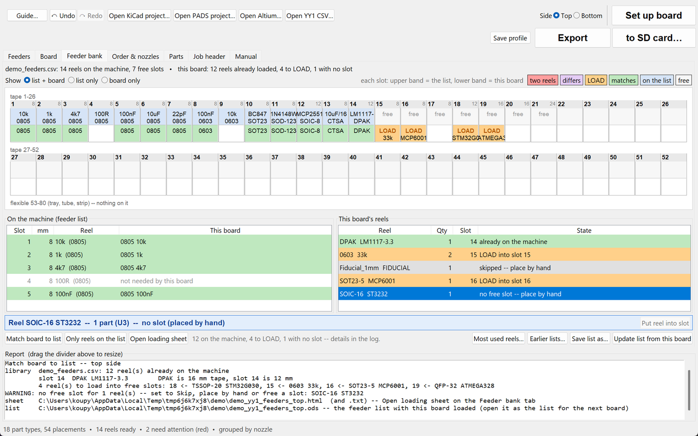
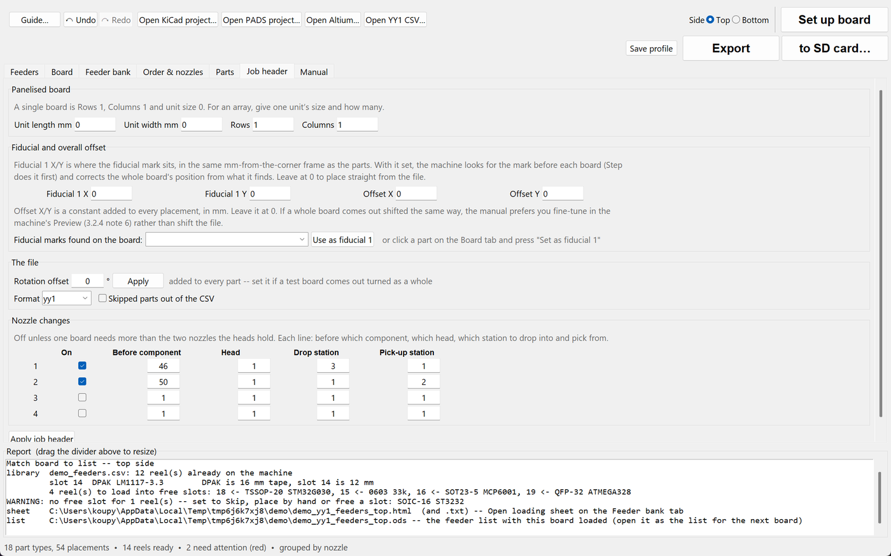
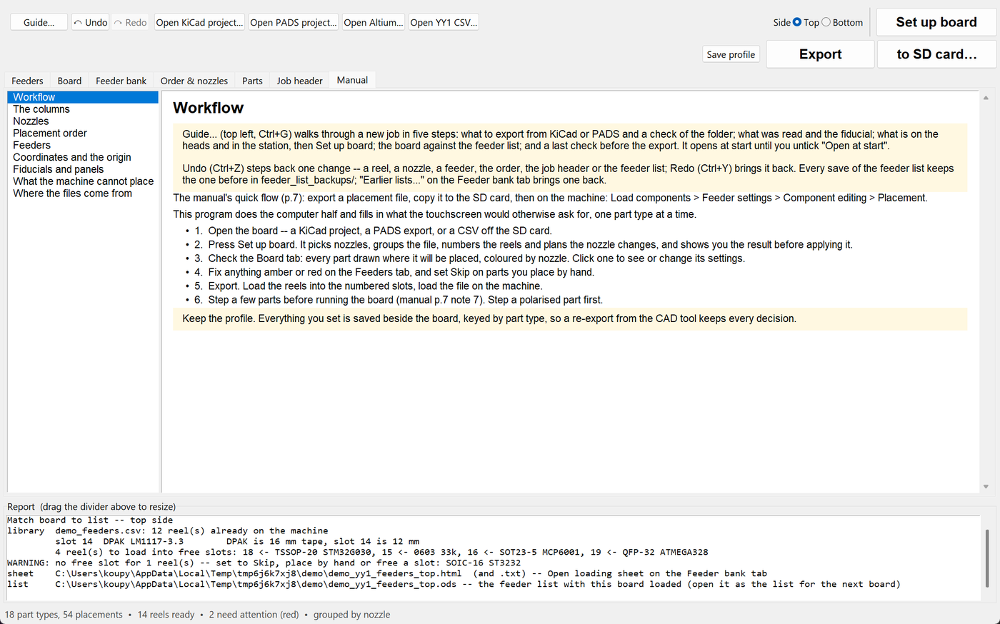

# NeoDen YY1 converter — user guide

From a board in KiCad, PADS Layout or Altium Designer to the SD card of a
NeoDen YY1, with the feeders, nozzles and nozzle changes decided for you. The
pictures below are of the demo board in `examples/` — run
`python examples/make_demo.py` and open `examples/demo_yy1_top.csv` to follow
along.

1. [Install](#1-install)
2. [What to export from your CAD tool](#2-what-to-export-from-your-cad-tool)
3. [The window](#3-the-window)
4. [A job, step by step: the Guide](#4-a-job-step-by-step-the-guide)
5. [Set up board](#5-set-up-board)
6. [The feeder list: reels that stay on the machine](#6-the-feeder-list-reels-that-stay-on-the-machine)
7. [Export, and what goes to the machine](#7-export-and-what-goes-to-the-machine)
8. [Fixing things by hand](#8-fixing-things-by-hand)
9. [Undo, backups and the profile](#9-undo-backups-and-the-profile)
10. [Command line](#10-command-line)

---

## 1. Install

**Windows:** download `yy1_converter.exe` from the
[releases page](https://github.com/koupypavel/neoden_yy1_converter/releases)
and run it. One file, nothing to install, no admin rights.

**Anywhere with Python 3.8+:** clone the repository and run
`python yy1_gui.py`. The tool uses only the standard library (tkinter comes
with Python). Reading `.xlsx`/`.xls` spreadsheets needs
`pip install -r requirements-optional.txt`.

## 2. What to export from your CAD tool

| CAD | What the tool reads | How to make it |
|---|---|---|
| **KiCad** | `production/…positions.csv` + `…bom.csv` beside the `.kicad_pcb` | Install the *Fabrication Toolkit* plugin (Plugin and Content Manager). In the PCB editor press its toolbar button and *Generate*. Keep *Apply automatic component translations* ticked. |
| **PADS Layout** | `.asc` ASCII export in the project folder | *File → Export…*, type *ASCII (\*.asc)*, tick *Parts* and *Lines*. Values come from the file's attributes; a BillOfMaterials report or a PADS Logic `.txt` export beside it fills gaps. |
| **Altium Designer** | the `.PcbDoc` itself | Nothing to export. Values are the parts' *Comment*; a BOM `.xlsx` with *Comment* and *Designator* columns beside the board overrides them. |
| **The machine** | a `…_yy1_top.csv` off the SD card | *Open YY1 CSV…* — with the profile copy beside it, the nozzles and reel settings come back too. |

Through-hole parts are dropped automatically (the YY1 places SMD only); so
are fiducials and parts too large or too small for the nozzles.

## 3. The window



The top bar is the job in order: **Guide…**, **Undo / Redo**, the **Open**
buttons, the **Side** (one file per side), then the two big buttons —
**Set up board** and **Export** (next to the board, or **to SD card…**).

The tabs, also in working order:

| Tab | What it is for |
|---|---|
| **Feeders** | One row per reel (footprint + value, the way the machine groups parts): feeder slot, nozzle, head, speed, pick/place height, recognition mode, skip, rotation offset. Green = ready, amber = still on the default slot, red = something the machine would trip over, grey = skipped. Double-click a cell to edit it; right-click for nozzle, skip and merge. |
| **Board** | The board drawn to scale, every part coloured by nozzle. Click a part to see and change its settings; *Set as fiducial 1*. |
| **Feeder bank** | The machine's 52 tape slots as a picture, with your feeder list and this board's reels overlaid. See [section 6](#6-the-feeder-list-reels-that-stay-on-the-machine). |
| **Order & nozzles** | Placement order, where each nozzle starts (heads and station), the nozzle drawer, the nozzle-change plan. |
| **Parts** | One row per designator, for a single-part override (a rotated LED, say). |
| **Job header** | Panelisation, fiducial and offset, rotation offset, file format, and the four nozzle-change rows the machine reads. |
| **Manual** | The built-in reference: every column, nozzle photos, the feeder banks, the rules the planner follows. |

The **Report** box under the tabs says what every action did; the status
line at the bottom counts what is ready and what needs attention.

## 4. A job, step by step: the Guide

**Guide…** (top left, Ctrl+G; it opens at start until you untick *Open at
start*) walks a new board through in five steps and drives the tabs as it
goes, so you can see what it does.



1. **Board files** — pick KiCad, PADS or Altium; the guide says what to export
   and checks the folder: the board, the export and its date, the BOM, which
   of several boards the export belongs to.
2. **Check the board** — size, parts per side, reels, what was left out and
   why, the side to do now, the fiducial (one click when the board has marks).
3. **Heads and nozzles** — say what is on the machine now, or let the
   planner choose from your drawer; then *Set up board*.

   

4. **Feeders** — match the board against your feeder list: use the reels on
   the machine and load the rest into free slots, or place only what is on
   the machine and do the rest by hand.
5. **Check and export** — red and amber reels, the nozzle changes against
   the four the machine holds, the fiducial; then export and open the
   operator sheet.

## 5. Set up board

One button decides everything for the side on screen and shows you the plan
before applying it. Nothing is saved until *Export* or *Save profile*.



What it does, in order:

- **A nozzle per reel**, from the body size (manual Table 1-2) or the package
  name. Two 0805 reels and a QFP need different tips.
- **No more nozzle types than fit**: the two heads plus the station
  positions, minus one kept empty for the drop. Parts whose nozzle does not
  fit go to the next smaller one; what nothing can pick is set to Skip. With
  *Plan only with these* ticked on the Order & nozzles tab, only nozzles you
  own are used.
- **Where each nozzle starts** — the most-used on the heads, the rest parked
  in the station. Homes you set by hand are kept.
- **The file grouped by nozzle** and the **feeders numbered** in that order —
  or, with a feeder list loaded, matched against it (section 6).
- **The nozzle changes**: before which component the head parks its nozzle
  and picks the next, at most four, written into the job header.



The Board tab shows the result: every part coloured by its nozzle, the
fiducial marked. Click a part for its settings.



On the Order & nozzles tab you can move a nozzle to a head or station by
hand, put the same nozzle on both heads (*Quick set-up*), enter the nozzles
you own, and see the change plan recomputed as you go.

## 6. The feeder list: reels that stay on the machine

Most workshops keep the common reels loaded — 10k, 100nF, the usual
transistors — and only change the rest between boards. The **feeder list**
is that set: a spreadsheet (`.ods`, `.xlsx`, `.csv`) with columns *slot*,
*tape width mm*, *value*, *footprint* (see `examples/demo_feeders.csv`). Load
it with *Feeder list…* on the Feeders tab; it is remembered across boards.



The **Feeder bank** tab draws the machine: tape slots 1–26 and 27–52 in two
rows, the flexible bank 53–80 below. Each slot has two bands — the upper is
the list, the lower is this board:

| Colour | Meaning |
|---|---|
| blue (upper band) | a reel is on the list here |
| green | the board's reel is the one the list says is there |
| orange **LOAD** | a reel to load into this slot for this board |
| purple ≠ | the board puts a different reel here than the list has |
| red | two of the board's reels claim one slot |

Under the picture, what has no slot at all (place by hand), then the two
tables — the list with what this board makes of each slot, and the board's
reels with where each goes — and a blue bar naming what is selected.

- **Match board to list** — reels the list has keep their slot; the rest go
  into free tape slots of the right width; what has no free slot is set to
  Skip and listed as *place by hand*.
- **Only reels on the list** — for a run that places just what is on the
  machine; everything else goes to the bench. It offers to leave skipped
  parts out of the CSV altogether.
- Both write a **loading sheet** beside the project — what to load where,
  what to take out first, what to check, what goes by hand — and the
  **completed list** as `.ods`: the feeder list with this board's reels in
  their slots, ready to be the list for the next board.
- **Moving a reel:** click the reel in the right-hand table, then a slot,
  then *Put … into slot N*. Right-click a slot to take a reel out, or to
  correct what the list says is there. *Update list from this board* writes
  every slot the board uses into the list.
- **Most used reels…** scans a folder of projects (any format, any depth)
  and counts on how many boards each reel is needed — the way to choose the
  static set in the first place. Tick the ones to keep and they go into the
  list's free slots.
- **Earlier lists…** brings back any earlier version of the list; one is
  kept in `feeder_list_backups/` every time it is saved.

## 7. Export, and what goes to the machine

**Export** writes, next to the board (or to the SD card with *to SD card…*):

- `<board>_yy1_top.csv` (and `_bottom.csv`) — the machine's own 13-column
  file with the job header: panel, fiducial, nozzle changes.
- `<board>_yy1_top_setup.html` and `.txt` — the **operator sheet**: nozzles
  on the heads and in the station, the nozzle changes as the machine's
  screen asks for them, every feeder slot with its reel, nozzle and
  designators, marked *on machine* or *LOAD*, and what is placed by hand.
  The HTML has tick boxes that the browser remembers; print it.
- `<board>_yy1_feeders_top.html` and `.txt` — the **loading sheet**: what to
  load into which slot, what to take out first, what is already on the
  machine, what goes by hand.
- `<board>_yy1_feeders_top.ods` — the **feeder list as it will be** once the
  reels are loaded, in the same columns as your list. On the SD card it is
  at hand at the machine; back at the desk it is the list for the next board.
- `<board>_yy1_profile.json` — a copy of the profile, so a card that comes
  back from the machine opens with the same nozzles and settings.



The Job header tab is what the header carries: panel rows and columns, the
fiducial and overall offset, the rotation offset, the file format, whether
skipped parts stay in the file with Skip = 1 or are left out, and the four
nozzle-change rows.

**A panel that only fits the machine turned:** on the Job header tab, set
*Board on the machine turned* to 90°, 180° or 270° (counter-clockwise, seen
from above). The whole board turns: every position and part rotation, the
board size (width and height swap at 90° and 270°), the fiducial and the
panel rows and columns. The Board tab then shows it as it will lie on the
machine. The setting is saved with the board, and a file read back off the
SD card comes back with it.

On the machine: load the reels per the sheet, check the nozzles, load the
file, then **Step** the first part of each reel before running the board.
Step a polarised part first. If a whole board comes out turned, set the
rotation offset; if one reel does, set *Rot +* on that row.

## 8. Fixing things by hand

- **Wrong footprint or value name** — double-click the cell on the Feeders
  tab and rename it; the profile remembers the rename for the next export.
- **Two values that are one reel** (10uF and 10uF/16V) — select both rows,
  right-click, *Merge selected reels…*. *Find look-alikes…* finds them for
  you. A reel placed from another footprint's reel (0603 10k from the 0805
  reel) is *Group values…* with *any footprint*.
- **A part to place by hand** — *Skip* = 1 on its row, or right-click, *Skip
  selected*.
- **A stick (vibration) feeder or tray** — give the reel a slot from 53 to
  80 and its pick height; the setup sheet lists it there.
- **The machine's own settings** — *File → Import settings from a machine
  CSV…* reads a file you edited on the machine and keeps its feeder numbers,
  modes and heights.



The **Manual** tab explains every column and option, with the nozzle table
and photos, and cites the YY1 user manual by page.

## 9. Undo, backups and the profile

- **Undo / Redo** (Ctrl+Z / Ctrl+Y) step through the last sixty changes to
  reels, nozzles, feeders, order, job header and the feeder list.
- Every save of a feeder list keeps the old file in `feeder_list_backups/`.
- Everything you decide lives in `<board>_yy1_profile.json` beside the
  project: renames, merges, feeders, nozzles, homes, changes, the fiducial.
  Re-export from the CAD tool and open again — it all comes back.
- The nozzle drawer and the feeder list path are machine facts, remembered
  in `~/.yy1_converter.json`.

## 10. Command line

Everything the window does with a board, the converters do from a shell:

```bash
python kicad2yy1.py path/to/kicad_project --setup        # plan nozzles, feeders and changes
python pads2yy1.py path/to/pads_project
python altium2yy1.py path/to/board.PcbDoc --outdir /media/sdcard
python yy1survey.py path/to/all/projects --list feeders.ods --top 20 --write static.ods
python verify_yy1.py                                     # checks output against a machine-run file
```

`--help` on each lists the options; README.md has the format, the rules and
the reasoning behind them.
